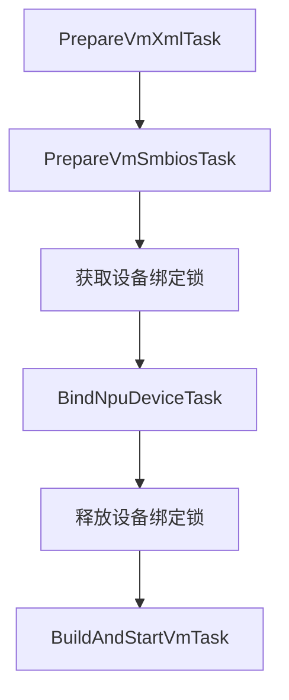

# ub-device-manager 设计说明

本文说明 ub-device-manager 的整体架构、框架选型、对外接口实现、UBS Engine（UBSE）调用，以及设备返回值到虚拟机 XML 的转换流程，供开发和维护人员理解当前实现。

本文以当前源码中的 NPU 与配套 Hi1825 网卡直通流程为主。服务同时注册了 SSU 应用，但SSU相关功能还在开发阶段，本文不展开讨论。NPU直通的操作步骤见[快速开始](./quick_start.md)，手动填写 XML 的方法见[NPU 直通虚拟机 XML 配置指南](./npu_passthrough_xml.md)。

## 1. 设计目标

组件接收用户准备的基础虚拟机 XML，将设备选择、UBSE 分配、直通 XML 生成和 libvirt 虚拟机管理连接起来，对外提供统一的查询、绑定、创建和删除入口。

| 参与方 | 职责                                                 |
| --- |----------------------------------------------------|
| 调用方 | 提供基础 XML、UPI 和设备需求；准备 CPU、内存、磁盘、固件、网络和大页等资源。       |
| ub-device-manager | 校验请求、选择设备、编排外部调用、生成 UB 和 Type 131 配置、处理异常。         |
| UBSE | 提供宿主 UB 设备信息，分配和绑定设备，提供 bus instance 及设备，释放绑定。 |
| libvirt | 接收完整 XML，定义、启动、查询和删除虚拟机。                           |
| 配套 QEMU 与内核驱动 | 实现 UB、UMMU、设备映射和虚拟机运行能力。                           |

## 2. 整体架构与框架

### 2.1 框架与用途

| 框架或机制 | 当前用途 |
| --- | --- |
| Python 3.11、`asyncio` | 组织异步请求和任务；使用 `asyncio.to_thread` 调用同步的 UBSE、libvirt 和 SMBIOS 读取逻辑。 |
| FastAPI、Uvicorn | 定义 HTTP 路由并运行 ASGI 服务，通过本地 Unix Domain Socket 接收请求。 |
| Pydantic | 定义请求、响应和内部数据模型，校验类型、枚举及字段格式。跨字段和设备状态校验由业务层补充。 |
| 自定义 `AsyncTaskChain` | 将一次操作拆为顺序执行的任务，共享请求上下文并支持命名锁和异常处理。 |
| HTTPX | SDK 和 CLI 的同步 HTTP 客户端，通过 UDS 访问服务。 |
| Typer、Rich、PyYAML | 根据本地 OpenAPI 契约生成 CLI，解析命令参数并展示表格、树形结果和错误信息。 |
| defusedxml、ElementTree | 前者解析并检查输入 XML，后者构建和序列化输出 XML。 |
| Loguru、ContextVar | 输出日志，并在异步请求中传递请求标识和任务上下文。 |
| systemd、TOML | 管理服务进程和运行参数。 |

`AsyncTaskChain` 在当前 HTTP 请求内执行，接口等待任务完成后返回结果。它不是后台任务队列，不产生可供后续轮询的任务 ID，也没有持久化任务状态。

### 2.2 模块分工

| 模块 | 主要职责 |
| --- | --- |
| `run.py` | 初始化日志和 UDS，启动 Uvicorn，设置 Socket 权限。 |
| `common/factory.py` | 合并 VM、NPU、SSU 路由，注册请求标识、耗时和异常处理中间件。 |
| `app/` | 声明接口模型及路由，组装对应任务链。 |
| `domain/npu/` | 设备库存转换、FE 与宿主拓扑读取、亲和筛选、UBSE 分配与释放。 |
| `domain/vm/` | 读取基础 XML、解析内存 NUMA 绑定、转换 UB 配置、解析 Type 131、调用 libvirt。 |
| `common/async_task_framework.py` | 任务生命周期、请求上下文、命名锁及退出清理。 |
| `ub_dm_sdk/` | 提供 Python 调用函数、客户端模型及 UDS HTTP 客户端。 |
| `ub_device_manager_cli.py`、`openapi.yaml` | 动态生成命令并转换命令参数与 HTTP 请求。 |

## 3. HTTP、SDK 与 CLI 的实现

### 3.1 HTTP 服务

`run.py` 将 `common.factory:final_app` 交给 Uvicorn，监听 `/var/run/ub_device_manager/ub_device_manager.sock`。当前服务入口不配置 TCP 监听；HTTP 客户端中的主机名只是逻辑地址，实际通过 UDS 建立连接。

`factory.py` 使用 `new_app.router.routes.extend(...)` 合并各业务应用的路由。NPU 和 VM 的主要接口如下：

| HTTP 接口 | 业务入口 | 结果 |
| --- | --- | --- |
| `GET /npu` | `QueryNpuTask` | NPU 设备列表。 |
| `POST /npu/bind` | `BindNpuDeviceTask` | `bus_guid`、`tid`、`uba`、`size` 和设备列表。 |
| `POST /npu/unbind` | `UnbindNpuDeviceTask` | 解绑完成消息。 |
| `POST /vm/create` | XML 准备、设备绑定、XML 构建与启动任务链。 | 创建完成消息。 |
| `DELETE /vm/{name}` | 虚拟机删除、设备解绑任务链。 | 删除完成消息。 |

FastAPI 使用服务端 `app/models.py` 校验请求。任务层进一步校验 XML 输入二选一、设备 ID/数量互斥、重复 ID、允许数量以及设备是否空闲。当前 NPU 数量支持 1、2、4、8，UPI 范围为 `0x0001`～`0x0fff`。

响应模型决定成功结果的 JSON 结构。异常处理器将 Pydantic 校验错误转换为 422，将业务 `HTTPException` 转换为对应状态码，将其他未处理异常转换为 500。当前异常响应体为 JSON 字符串，不统一包装成 `{code, msg}` 对象。响应头包含 `X-Request-ID` 和 `X-Process-Time`，用于关联日志和处理耗时。

### 3.2 Python SDK

SDK 通过 HTTPX 和 UDS 调用服务，不直接访问 UBSE 或 libvirt。封装函数用 `model_dump(exclude_none=True)` 整理请求模型，`UbDeviceManagerClient` 发送 HTTP 请求、调用 `raise_for_status()` 并解析响应，再由封装函数整理返回值。每次请求创建并关闭客户端，且设置 `trust_env=False`。UDS 路径依次取显式参数、`UBDM_UDS_PATH` 和默认路径；默认超时为 10 秒，耗时操作可自行调大。

| SDK 函数 | HTTP 接口 | 返回值 |
| --- | --- | --- |
| `get_host_npu_device()` | `GET /npu` | `NpuDeviceInfo` 列表。 |
| `bind_npu_device()` | `POST /npu/bind` | `(tid, uba, size, bus_guid, devices)`。 |
| `unbind_npu_device()` | `POST /npu/unbind` | 无业务数据。 |
| `create_vm()`、`delete_vm()` | `POST /vm/create`、`DELETE /vm/{name}` | 服务端结果字典。 |

SDK 与服务端分别定义请求模型，服务端仍需独立校验。

### 3.3 CLI

CLI 读取程序目录内的 `openapi.yaml`，使用 YAML SafeLoader 解析，并解析 schema 引用、HTTP 方法、路径参数、请求体属性、类型和必填项。

生成规则如下：

| OpenAPI 内容 | CLI 表现 |
| --- | --- |
| 路径第一段，如 `/npu`、`/vm` | Typer 命令分组 `npu`、`vm`。 |
| `GET /npu` | `ubdmctl npu list`。 |
| `POST /npu/bind`、`POST /vm/create` | `ubdmctl npu bind`、`ubdmctl vm create`。 |
| `DELETE /vm/{name}` | `ubdmctl vm delete NAME`，路径字段作为位置参数。 |
| 请求体和查询字段 | `--字段名` 选项，例如 `--npu_ids`。 |

`build_executor()` 使用 `inspect.Signature` 生成 Typer 可识别的函数签名。原始选项先作为字符串接收，再按契约转换为整数、布尔值、列表或对象；路径值填入 URL，查询值放入查询参数，请求体字段组成 JSON。未识别的额外参数会被拒绝。

CLI 直接通过 HTTPX 访问服务，没有调用 Python SDK 函数。当前超时为 1200 秒。成功响应按数据形态展示为 Rich 表格或树；失败时显示 HTTP 状态和错误内容，并以非零退出码结束。`--verbose` 展示请求参数和更详细的错误信息。

CLI 使用随包提供的静态 OpenAPI 文件，不会在启动时自动向服务端获取契约。新增接口或修改字段时，应同步维护服务端模型、`openapi.yaml`、SDK 和对应测试，避免客户端与服务端不一致。

## 4. UBSE 接口与绑定结果的形成

### 4.1 调用封装

`NpuClient` 封装 `ubse.ubs_engine_npu` 中的同步接口，使用 `asyncio.to_thread` 在线程中调用，使同步外部操作不直接阻塞 ASGI 事件循环。以下是当前 UBDM 使用的调用形式，不代表 UBSE 接口的全部能力：

| UBSE 接口 | 当前传入参数 | 当前接收结果及用途 |
| --- | --- | --- |
| `get_host_ub_devices()` | 无。 | 设备库存对象列表，用于查询、选择和解绑前定位设备。 |
| `alloc_devices(...)` | `upi`、`bus_guid`、`device_list`。 | 以 `bus_guid, _` 接收，使用第一个返回值作为本次 bus instance GUID，第二个返回值当前不使用。 |
| `query_uba_tid_size(...)` | `bus_instance_guid=bus_guid`。 | 接收 `(tid, uba, size)`，用于生成 `ubmem_vmmu` 参数。 |
| `free_devices(...)` | `bus_instance_guid`、`device_list`。 | 不使用业务返回值；异常向上反馈，用于解绑和失败补偿。 |

`NpuClient` 初始化时还会注册一次进程级 UBSE 日志回调，当前回调不转发日志内容；UBDM 在自身调用和业务层记录操作日志。

### 4.2 库存字段与设备选择

库存查询结果先转换为内部 `UbDeviceInfo`：

| UBSE 库存字段 | UBDM 字段 | 用途 |
| --- | --- | --- |
| `device_id` | `id` | 用户选择设备，以及构造分配、释放请求。 |
| `device_type` | `type` | 区分 NPU、NIC_PFE 和 NIC_VFE。 |
| `guid` | `guid` | 后续 hostdev XML 中的设备 GUID。 |
| `bus_instance` | `bus_guid` | 判断是否已绑定，或按 bus instance 定位待释放设备。 |
| `affinity_devs` | `affinity_devs` | 查找配套 NIC_VFE，以及用于确定 NUMA 亲和关系的 P_IDEV。 |

适配层保留 NPU、NIC_PFE 和 NIC_VFE 库存，`GET /npu` 只返回其中的 NPU。选择器以 `(type, id)` 建立索引，避免仅凭 ID 混淆不同类型的设备。

指定 ID 时，检查目标 NPU 存在且 `bus_guid` 为空。指定数量且未传亲和策略时，按库存遍历顺序选择前若干个空闲 NPU。`need_nic=True` 时，仅选择具有可用配套 NIC_VFE 的 NPU，并将 NIC_VFE 追加到设备列表；不会把 NIC_PFE 当作网卡直通对象。

配套网卡关联与内存亲和选择是两个规则：前者从 `affinity_devs` 查找 NIC_VFE，后者使用其中的 P_IDEV 定位 NPU 对应的宿主 NUMA。

#### 内存与 NPU 亲和选择

`POST /vm/create` 的 `affinity_policy` 只用于 `npu_count` 自动选卡。与 `npu_ids` 同传或未提供 `npu_count` 时，在读取 XML 和查询设备前返回 400；省略或传 `null` 时保持原有选卡行为。`POST /npu/bind` 不接收该参数。

启用策略时，`VmMemoryAffinityParser` 要求基础内存全部使用大页，并明确绑定宿主 NUMA；`placement`、`mode` 分别按 `static`、`strict` 校验，省略属性时也按这两个值解析。`<devices><memory>` 附加内存设备不在当前解析范围内，启用策略时返回 400。

对每个虚拟机 NUMA 节点，优先采用其 `numatune/memnode`，否则采用通用的 `numatune/memory`；将实际采用的宿主 NUMA 编号去重，得到集合 **`N`**。每个内存单元可以绑定多个宿主 NUMA，允许跨 Socket；

`HostTopologyProvider` 从本次 UBSE 库存的每张 NPU 的 `affinity_devs` 中取得 `P_IDEV.device_id`（UB FE ID），读取 `/sys/bus/ub/devices/{FE ID}/numa`，将 `0x03` 等十六进制值转成宿主 NUMA 编号。再根据 `/sys/devices/system/cpu/cpu*/node*` 和 `topology/physical_package_id` 确定 NUMA 所属 Socket。

FE ID 保留原字符串，不从 NPU ID 或 GUID 推算。直通 VFE 继承 FE 亲和关系，生成 XML 时仍使用待直通设备的 GUID。服务账户须能读取上述 sysfs 文件并遍历其目录。

当前实现检查库存中的全部 NPU，包括已绑定设备：每张必须恰有一个 `P_IDEV`，其 NUMA 必须可读取并对应有效宿主节点；否则在分配前返回 503。Socket 无法确定时记为未知，`socket` 策略遇到内存节点 Socket 未知会选择失败。拓扑来自实时 UBSE 查询和 sysfs，无需 `npu-smi`、固定拓扑文件或数据库。

将 `N` 中各宿主 NUMA 所属的已知 Socket 编号去重，得到集合 **`S`**。每张候选 NPU 的亲和 NUMA 来自其 FE，亲和 Socket 来自该 NUMA。选择前排除已绑定 NPU；`need_nic=True` 时还需排除没有空闲配套 NIC_VFE 的 NPU。

| 策略 | 选择规则 |
| --- | --- |
| `required` | 仅选亲和 NUMA 属于 `N` 的 NPU。 |
| `socket` | 仅选亲和 Socket 属于 `S` 的 NPU。 |
| `preferred` | 先选亲和 Socket 属于 `S` 的 NPU，不足时从其他空闲 NPU 补足；不额外优先亲和 NUMA 属于 `N` 的 NPU。 |

各优先级内按设备 ID **字符串升序**选取；符合条件的设备不足返回 545，不保证各 NUMA 或 Socket 的 NPU 数量均衡。XML 内存绑定引用的宿主 NUMA 是否存在，也在选卡阶段校验；不存在时当前返回 545，应修正 XML 中的宿主 NUMA 编号。指定 `npu_ids` 时不接受亲和策略，仍按原流程检查设备与配套网卡。

XML 配置示例见 [CLI 使用指导](./cli_userguide.md#可选内存亲和策略)。

### 4.3 从分配请求到绑定结果

选择设备后，UBDM 用其 `device_id` 和 `device_type` 构造 `device_list`；调用 UBSE 时去掉 UPI 的 `0x` 前缀，并以空 `bus_guid` 创建新的 bus instance。绑定结果的字段分别来自以下接口：

| 来源 | 结果字段 |
| --- | --- |
| `get_host_ub_devices()` | 已选设备的类型、ID 和 GUID。 |
| `alloc_devices()` | `bus_guid`。 |
| `query_uba_tid_size()` | `tid`、`uba`、`size`。 |

这些字段组合成 `BindNpuDeviceResult`，供 XML 构建和异常补偿使用。

## 5. 绑定结果如何转换为 XML

`VmXmlBuilder` 使用用户的基础 XML、`BindNpuDeviceResult` 和宿主机 `SmbiosType131` 生成最终 domain XML。用户已有的普通虚拟机配置作为基础保留，组件补充 UB 直通和服务器类型信息。

### 5.1 转换规则

| 输入或生成规则 | XML 位置 | 处理方式 |
| --- | --- | --- |
| XML 命名空间常量 | `qemu:commandline` | 使用 `http://libvirt.org/schemas/domain/qemu/1.0` 命名空间。 |
| 固定标识 `1` | `<iommufds>1</iommufds>` | 为 UB hostdev 提供一致的 IOMMUFD 引用；当前拒绝其他非空标识值。 |
| `bus_guid` | `devices/controller/source/businstance/@guid` | 使用原始 bus instance GUID。 |
| `bus_guid` 派生值 | UB controller 的 `address/@guid` | 按 `-` 分隔，将第 4 段改为 `2`，其他段不变。 |
| `len(devices)` | UB controller 的 `ports/@num` | 包含所有待直通设备，配套 NIC_VFE 也计入端口数。 |
| 固定配置 | UB controller | `type='ub'`、`index='0'`、子节点 `<model name='ubc'/>`、地址 `eid='0x1'`。 |
| 每项 `devices[i].guid` | hostdev 的 source 地址及 UB 地址 | 两处均写该设备 GUID；driver 为 `vfio`，`managed='yes'`，`iommufd='1'`。 |
| 设备顺序 `i`，从 0 开始 | hostdev 地址、端口和 alias | `eid=hex(i+2)`，`tport=str(i)`，`teid='0x1'`，端口 `index='0'`，alias 为 `ub-i`。 |
| 固定模型 | `devices/iommu` | 添加 `<iommu model='ummu'/>`；已有该模型时复用。 |
| `tid`、`uba`、`size` | `qemu:commandline` | 生成 `-device` 和 `ubmem_vmmu,tid=...,uba=...,size=...` 两个参数。 |
| 宿主机 Type 131 解析结果 | `sysinfo/type131/entry` | 数值转为十进制字符串，写入服务器组网信息。 |
| SMBIOS 使用模式 | `os/smbios/@mode` | 设置为 `sysinfo`，让配套虚拟化组件使用所提供的信息。 |

IOMMUFD 标识 `1` 与 UBSE 返回的 `tid` 属于不同配置，不能互相替代。设备 ID 用于查询和分配，设备 GUID 用于 XML；原始 bus GUID 用于绑定关系和释放，controller 的派生地址 GUID 不能用来解绑。

完整 XML 示例见 [NPU 直通虚拟机 XML 配置指南](./npu_passthrough_xml.md)。

### 5.2 Type 131 的来源

`PrepareVmSmbiosTask` 在 UBSE 分配前调用 `VmSmbios`，以 `/usr/bin/sudo -n /usr/sbin/dmidecode -t 131 -u` 读取一次宿主 SMBIOS Type 131，超时 60 秒，不重试。Type 131 用于向虚拟机传递服务器组网信息；解析结果放在本次请求的任务上下文中。

解析器检查记录类型、长度和 `Flag=0`。下表偏移从 `Header and Data` 的首字节起算，多字节字段按小端序读取；XML 值写为十进制字符串。

| 偏移 | 宿主字段 | XML 属性 |
| --- | --- | --- |
| `04h` | Flag | `flag` |
| `05h`～`06h` | PodId | `pod_id` |
| `07h` | SlotId | `slot_id` |
| `08h` | Mesh_Type | `mesh_type` |
| `09h`～`0Ch` | SuperPodId | `super_pod_id` |
| `0Dh`～`0Eh` | ServedIndex | `served_index` |

`type_name` 固定为 `UB INFO`。`VmXmlBuilder` 将这些属性写入 `sysinfo/type131/entry`，并将 `os/smbios/@mode` 设为 `sysinfo`；已有 SMBIOS `sysinfo` 时保留其他条目，只更新 Type 131。客体内仍需读取 Type 131 核对结果。

## 6. 创建流程与异常补偿

### 6.1 正常创建

`PrepareVmXmlTask` 校验请求和基础 XML 的大小、`domain` 根节点，并拒绝预先包含 UB controller、UB hostdev 或 `ubmem_vmmu` 的输入；启用亲和策略时还解析大页和内存绑定。请求 NPU 时，先读取 Type 131，再在绑定锁内查询库存、选择设备并调用 UBSE。锁释放后生成直通 XML，`VMClient` 通过本地 `qemu:///system` 定义并启动虚拟机。生成 XML 时保留用户原有的 CPU 和内存绑定。

不请求 NPU 时跳过 Type 131 和设备绑定，按基础 XML 创建普通虚拟机。

### 6.2 任务上下文与锁

任务链用独立 `Context` 传递基础 XML、内存绑定、Type 131 和绑定结果；任务结束时释放尚未主动释放的锁并恢复上下文。

创建路由只在查询库存、选卡和绑定期间持有 `vm_bind_npu_device` 锁。该锁仅在当前进程内生效，独立的 `/npu/bind` 路由也不使用它，因此不能作为全部资源操作的全局互斥保证。

### 6.3 失败处理

| 失败阶段 | 当前处理 |
| --- | --- |
| 输入参数、XML 结构或内存绑定格式校验失败 | 返回 400；参数类型或枚举校验失败返回 422，尚未分配设备。 |
| Type 131 读取或解析失败 | `PrepareVmSmbiosTask` 返回 543，尚未分配设备，无需解绑。 |
| 亲和拓扑读取或设备选择失败 | 拓扑读取失败返回 503；符合策略的空闲 NPU 不足、XML 内存绑定引用的宿主 NUMA 不存在等选卡错误返回 545，尚未分配设备。 |
| `alloc_devices()` 抛出异常 | 异常向上反馈；UBDM 没有在此分支额外执行库存核对或释放。 |
| 分配成功，但 `query_uba_tid_size()` 失败 | `NpuClient.bind_devices()` 使用分配所得 GUID 和设备列表调用 `free_devices()`，随后抛出异常。 |
| 绑定后的 XML 构建失败 | `BuildAndStartVmTask` 尝试释放本次绑定设备，再向上抛出错误。 |
| libvirt 已定义虚拟机，但启动失败 | `VMClient` 尝试用 `VIR_DOMAIN_UNDEFINE_NVRAM` 取消定义；外层创建任务再尝试释放设备。 |
| 创建阶段释放设备也失败 | 记录释放失败日志；`BuildAndStartVmTask` 保留其捕获的原始创建异常。资源状态需进一步核查。 |

## 7. 删除与解绑设计

删除路由执行 `DeleteVmTask → UnbindNpuDeviceTask`，顺序如下：

1. 通过虚拟机名称查询 libvirt domain，读取 XML 中 UB controller 的 `source/businstance/@guid`。当前删除逻辑取第一个 UB controller，与自动生成一个 controller 的流程对应。
2. 虚拟机运行时调用 `destroy()` 强制停止，再通过 `undefineFlags(VIR_DOMAIN_UNDEFINE_NVRAM)` 取消定义并处理 NVRAM。
3. 将原始 bus instance GUID 写入任务上下文。
4. 重新查询 UBSE 库存，选择 `bus_guid` 与该 GUID 相同的设备，构造 `device_id/device_type` 列表并调用 `free_devices()`。

普通虚拟机没有 UB controller 时，待解绑 GUID 为空，解绑任务跳过。删除流程不删除虚拟机磁盘文件。

独立的 `/npu/unbind` 只按 bus instance 释放设备，不停止或取消定义虚拟机。虚拟机已经取消定义但解绑失败时，需保留原始 bus GUID，核对设备状态后单独处理解绑，不能指望再次按名称删除已不存在的虚拟机完成恢复。

当前 UBDM 没有自己的持久化设备映射数据库：设备归属来自 UBSE 库存，虚拟机与 bus instance 的关联来自 libvirt XML。请求上下文仅保存本次操作中的中间数据。

## 8. 运行配置、日志与源码入口

RPM 将服务配置为 `ub-device-manager` 用户运行。systemd 创建运行目录，程序启动后将 UDS 权限设置为 `0660`。调用用户需具备该 Socket 的访问权限；服务账户访问 UBSE、libvirt 和通过 sudo 读取 Type 131 的权限分别由对应组件配置。

服务账户通过 `qemu:///system` 连接本地 libvirt。部署时在 `/etc/libvirt/libvirtd.conf` 设置 `auth_unix_rw = "none"`，关闭 libvirt Unix 读写 Socket 的连接认证；服务账户仍需具备该 Socket 的文件访问权限。修改后重启 libvirtd，操作步骤见[安装部署指导](./install.md#222-安装虚拟化组件)。

TOML 配置在进程启动时读取，主要控制日志级别、轮转和 XML 输入大小；修改后需要重启。路径加载顺序为存在的 `UBDM_CONFIG_PATH` 文件、`/etc/ub_device_manager/ub_device_manager.toml`、程序包内默认副本，不合并多个文件。具体操作见[配置文件说明](./configuration.md)和[安装部署指导](./install.md)。

日志默认写入 `/var/log/ub_device_manager/ub_device_manager.log`，支持轮转、压缩及可选标准输出。请求 ID 通过 ContextVar 关联同次请求中的日志，日志消息和 CLI 展示内容还会过滤控制字符。

| 源码入口 | 对应设计 |
| --- | --- |
| [run.py](../ub_device_manager/run.py)、[factory.py](../ub_device_manager/common/factory.py) | 服务启动、路由组合、中间件和错误处理。 |
| [app/models.py](../ub_device_manager/app/models.py)、[vm_app.py](../ub_device_manager/app/vm_app.py)、[npu_app.py](../ub_device_manager/app/npu_app.py) | 服务端模型与业务任务链入口。 |
| [async_task_framework.py](../ub_device_manager/common/async_task_framework.py) | 任务链、上下文和进程内锁。 |
| [npu_client.py](../ub_device_manager/domain/npu/npu_client.py)、[device_selector.py](../ub_device_manager/domain/npu/device_selector.py)、[npu_tasks.py](../ub_device_manager/domain/npu/npu_tasks.py) | UBSE 适配、设备选择、绑定与解绑。 |
| [affinity_policy.py](../ub_device_manager/domain/npu/affinity_policy.py)、[host_topology.py](../ub_device_manager/domain/npu/host_topology.py)、[vm_memory_affinity.py](../ub_device_manager/domain/vm/vm_memory_affinity.py) | 亲和策略、FE 与宿主拓扑、内存绑定解析。 |
| [vm_tasks.py](../ub_device_manager/domain/vm/vm_tasks.py)、[vm_client.py](../ub_device_manager/domain/vm/vm_client.py) | 创建、删除、libvirt 调用和补偿。 |
| [vm_xml_builder.py](../ub_device_manager/domain/vm/vm_xml_builder.py)、[vm_smbios.py](../ub_device_manager/domain/vm/vm_smbios.py) | XML 转换和 Type 131 读取、解析。 |
| [ub_dm_sdk](../ub_device_manager/ub_dm_sdk)、[ub_device_manager_cli.py](../ub_device_manager/ub_device_manager_cli.py)、[openapi.yaml](../ub_device_manager/openapi.yaml) | SDK 封装、CLI 生成与接口契约。 |

现有单元测试通过 Stub 和 Mock 隔离 UBSE、libvirt 及外部命令，用于验证参数处理、设备选择、XML 转换和异常分支；真实驱动、固件、设备访问与客体 NPU 功能仍需在配套服务器上验证。测试执行方法见[测试指导](./test.md)。
